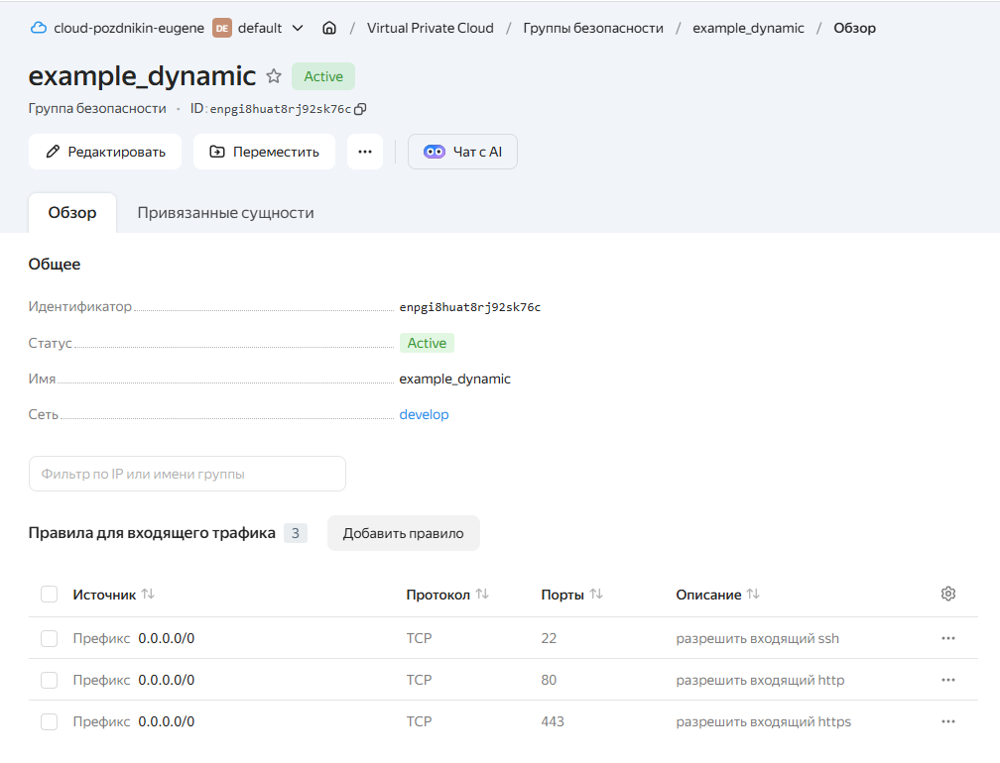
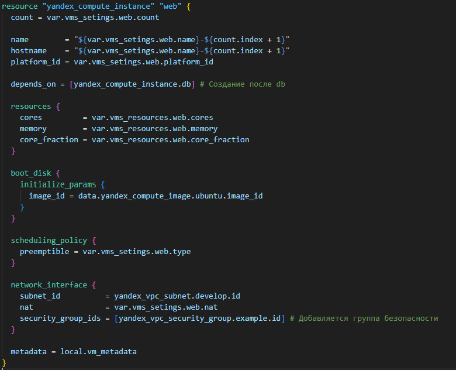
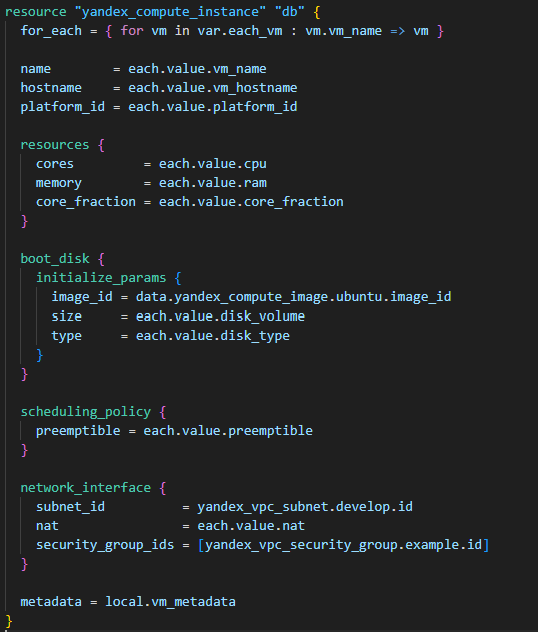
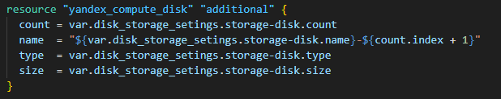
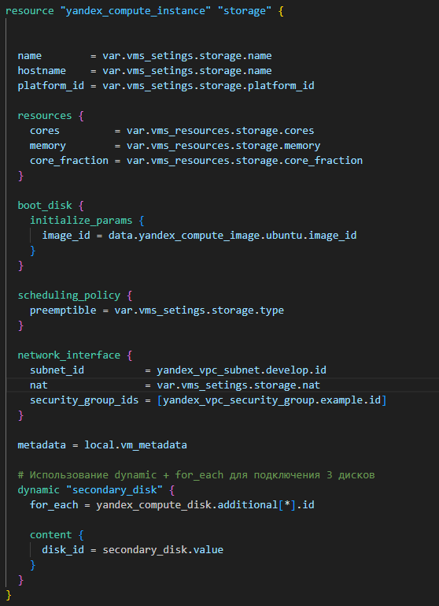
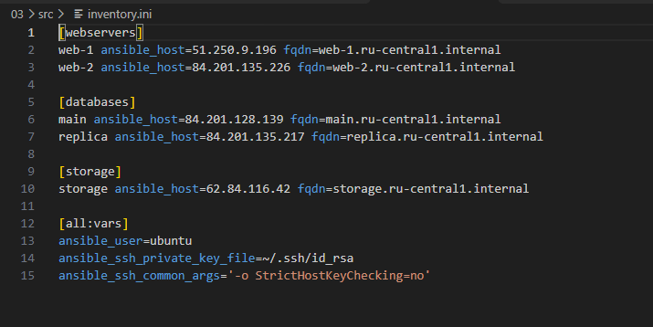

# Домашнее задание к занятию "`Управляющие конструкции в коде Terraform`" - `Поздникин Евгений`


### Инструкция по выполнению домашнего задания

   1. Сделайте `fork` данного репозитория к себе в Github и переименуйте его по названию или номеру занятия, например, https://github.com/имя-вашего-репозитория/git-hw или  https://github.com/имя-вашего-репозитория/7-1-ansible-hw).
   2. Выполните клонирование данного репозитория к себе на ПК с помощью команды `git clone`.
   3. Выполните домашнее задание и заполните у себя локально этот файл README.md:
      - впишите вверху название занятия и вашу фамилию и имя
      - в каждом задании добавьте решение в требуемом виде (текст/код/скриншоты/ссылка)
      - для корректного добавления скриншотов воспользуйтесь [инструкцией "Как вставить скриншот в шаблон с решением](https://github.com/netology-code/sys-pattern-homework/blob/main/screen-instruction.md)
      - при оформлении используйте возможности языка разметки md (коротко об этом можно посмотреть в [инструкции  по MarkDown](https://github.com/netology-code/sys-pattern-homework/blob/main/md-instruction.md))
   4. После завершения работы над домашним заданием сделайте коммит (`git commit -m "comment"`) и отправьте его на Github (`git push origin`);
   5. В личном кабинете прикрепите и отправьте ссылку на решение в виде md-файла в вашем Github.
   6. Любые вопросы по выполнению заданий спрашивайте в разделе “Вопросы по заданию” в личном кабинете.
   
Желаем успехов в выполнении домашнего задания!
   
### Дополнительные материалы, которые могут быть полезны для выполнения задания

1. [Руководство по оформлению Markdown файлов](https://gist.github.com/Jekins/2bf2d0638163f1294637#Code)

---

### Задание 1

Правила входящего трафика группы безопсности



---

### Задание 2

Конфигурация вм `web` 




Переменные объединены для web и storage

<details>
   
<summary> Переменные для вм web variables.tf  </summary>

```
# Для ВМ count и Storage 

variable "vms_resources" {
  type = map(object({
    cores         = number
    memory        = number
    core_fraction = number
  }))
  description = "Ресурсы ВМ (cores, memory, core_fraction) для каждой машины"
  default = {
    web = {
      cores         = 2
      memory        = 1
      core_fraction = 5
    }
    storage = {
      cores         = 2
      memory        = 1
      core_fraction = 5
    }
  }
}

# Общие переменные web и storage

variable "vms_setings" {
  type = map(object({
    name        = string #
    platform_id = string # 
    type        = bool   # preemptible
    nat         = bool   # Внешний ip-adress 
    count       = number # Количество ВМ 

  }))
  description = "Настройки ВМ"
  default = {
    web = {
      name        = "web"
      platform_id = "standard-v2"
      type        = true
      nat         = true
      count       = 2
    }
    storage = {
      name        = "storage"
      platform_id = "standard-v2"
      type        = true
      nat         = true
      count       = 0
    }
  }
}
```

</details>

Конфигурация вм `db`




<details>
   
<summary> Переменные для вм db variables.tf  </summary>
   
```
variable "each_vm" {
  type = list(object({
    vm_name       = string
    vm_hostname   = string
    platform_id   = string
    cpu           = number
    ram           = number
    core_fraction = number
    disk_volume   = number
    disk_type     = string
    preemptible   = bool
    nat           = bool

  }))
  description = "Параметры ВМ БД: main и replica"
  default = [
    {
      vm_name       = "main"
      vm_hostname   = "main"
      platform_id   = "standard-v2"
      cpu           = 2
      ram           = 1
      core_fraction = 5
      disk_volume   = 5
      disk_type     = "network-ssd"
      preemptible   = true
      nat           = true

    },
    {
      vm_name       = "replica"
      vm_hostname   = "replica"
      platform_id   = "standard-v2"
      cpu           = 2
      ram           = 1
      core_fraction = 5
      disk_volume   = 5
      disk_type     = "network-ssd"
      preemptible   = true
      nat           = true
    }
  ]
}
```
</details>

locals.tf

```
locals {
  ssh_public_key = file("~/.ssh/ter_yc.pub")

  vm_metadata = {
    serial-port-enable = 1
    ssh-keys           = "ubuntu:${local.ssh_public_key}"
  }
}
```

---

### Задание 3
Создание дисков 



Переменные для дисков `variables.tf`

```
variable "disk_storage_setings" {
  type = map(object({
    count = number
    name  = string
    type  = string
    size  = number
  }))

  description = "Настройки дисков"
  default = {
    storage-disk = {
      count = 3
      name  = "storage-disk"
      type  = "network-hdd"
      size  = 1
    }
  }
}
```

Конфигурация вм `storage'




### Задание 4

Файл `ansible.tf`

```
resource "local_file" "ansible_inventory" {
  content = templatefile("${path.module}/inventory.tftpl", {
    web_vms    = yandex_compute_instance.web
    db_vms     = yandex_compute_instance.db
    storage_vm = [yandex_compute_instance.storage]
  })
  filename = "${path.module}/inventory.ini"
}
```


Файл inventory.ini
```
[webservers]
%{ for vm in web_vms ~}
${vm.name} ansible_host=${vm.network_interface[0].nat_ip_address} fqdn=${vm.fqdn}
%{ endfor ~}

[databases]
%{ for vm in db_vms ~}
${vm.name} ansible_host=${vm.network_interface[0].nat_ip_address} fqdn=${vm.fqdn}
%{ endfor ~}

[storage]
%{ for vm in storage_vm ~}
${vm.name} ansible_host=${vm.network_interface[0].nat_ip_address} fqdn=${vm.fqdn}
%{ endfor ~}

[all:vars]
ansible_user=ubuntu
ansible_ssh_private_key_file=~/.ssh/id_rsa
ansible_ssh_common_args='-o StrictHostKeyChecking=no'
```

Создание инвентаризации `inventory.ini`


